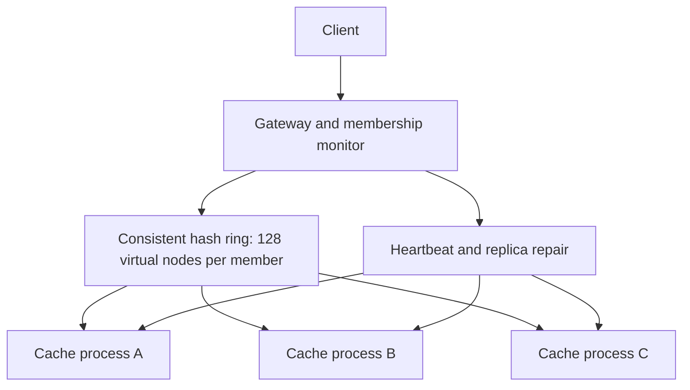

# Phoenix Cache — Self-Healing Distributed Cache

A runnable distributed-systems portfolio project by Aryan Das. Independent HTTP cache nodes, a consistent-hash ring, two-copy writes, heartbeat recovery, and automatic replica repair. Python 3.11+; no pip packages required.

## Run in two minutes

Extract this folder, open a terminal inside it, and run:

```sh
python run.py
```

On Windows, use `py run.py` if `python` is unavailable. Leave the terminal open. Ctrl+C stops the cluster.

In another terminal:

```sh
curl -X POST http://127.0.0.1:8080/cache/hello -H 'Content-Type: application/json' -d '{"value":"Hello Aryan","ttl":60}'
curl http://127.0.0.1:8080/cache/hello
curl http://127.0.0.1:8080/status
```

PowerShell equivalent for writing:

```powershell
Invoke-RestMethod http://127.0.0.1:8080/cache/hello -Method Post -ContentType 'application/json' -Body '{"value":"Hello Aryan","ttl":60}'
```

Or use containers:

```sh
docker compose up --build
```

Only the gateway port is published, bound to localhost. Containers are supplied but were not executed in the build environment.

## Prove it survives a crash

```sh
python -m unittest discover -s tests -v
```

The integration test starts independent processes on temporary ports, seeds 30 keys, starts 100 read/write pairs, kills a seeded-random node during traffic, checks every response, restarts the empty node, and brings a preconfigured fourth node online. It verifies intended replica placement after recovery and joining, expiry of an overwritten value, and invalid TTL rejection. Processes are cleaned up automatically.

`CHAOS_RESULT` reports actual results for your machine. This test does not require the manually started cluster.

For a manual container demonstration, keep issuing reads while running:

```sh
docker compose kill node2
docker compose start node2
```

## Architecture



- **Partitioning:** SHA-256-derived 64-bit tokens; 128 virtual tokens per node. Clockwise traversal selects distinct replica owners. Adding a member only moves primary ownership to that new member.
- **Writes:** a single gateway orders versions and requires two successful node acknowledgments. Failed preferred owners are skipped in favor of subsequent live ring members. Fewer than two acknowledgments returns HTTP 503; partial writes can exist.
- **Reads:** query all configured nodes and choose the highest version. This intentionally favors correctness and easy inspection over low read amplification. When no node responds, return 503; a missing or expired record returns 404.
- **Failure detection:** health probes and repair scans run every 500 ms, plus time spent scanning. Failed calls time out after 600 ms. Recovery needs no client-side routing change.
- **Repair:** merge surviving node snapshots by version, then copy records to current ring owners. A new node must already appear in the gateway's configured node list. Known nodes can return empty and be rebuilt from surviving replicas.
- **TTL:** the gateway assigns one absolute expiration timestamp, copied unchanged across replicas. Reads choose the newest version before checking expiry; old values do not reappear after an overwrite expires.
- **Migration concurrency:** repair and gateway requests share a lock, preventing a stale migration from overtaking a write. Requests can queue during scans; there is no guarantee of bounded tail latency.

## API

| Method | Endpoint | Result |
| --- | --- | --- |
| POST | `/cache/KEY` | Write `{"value": <JSON>, "ttl": <optional seconds>}` |
| GET | `/cache/KEY` | Value, version, and absolute expiration; 404 on miss |
| GET | `/status` | Membership, recent changes, reads, writes, repair count |
| GET | `/health` | Process liveness (not cluster write readiness) |

URL-encode keys containing spaces or reserved characters. Request bodies are limited to 1 MiB. The internal `/snapshot` and `/internal/KEY` endpoints belong to node processes and are trusted infrastructure APIs.

## Measured validation

One local execution on 25 October 2026:

| Check | Observed result |
| --- | --- |
| Unit and integration tests | 4 passed |
| Client operations during crash experiment | 200 |
| Failed client operations | 0 |
| Client retries | 0 |
| Read/write pair p95 duration | 5.10 ms |
| Live nodes after restart and join | 4 |

The duration covers one read plus one write in a small local test, not production latency or a throughput benchmark. Results vary with hardware and load. Zero failures here demonstrates one single-node crash scenario; it is not a universal availability guarantee.

## Honest limits and next milestones

This is an educational prototype, not a Redis-compatible implementation or production database.

1. The gateway is a single point of failure and serializes requests. Multiple independent gateways, consensus, leader election, and partition-safe quorum reads are not implemented.
2. Rebalancing copies to new owners but retains historical copies. Expired records also remain as version barriers to prevent resurrection. Storage is unbounded. Safe garbage collection, tombstone compaction, and LRU/LFU eviction are future work.
3. Health detection uses simple probes, not gossip. Membership is statically configured, with automatic handling of a configured node coming online.
4. Reads fan out to every node; repair scans full snapshots. This is suitable for a small demonstration, not large keyspaces.
5. Two replicas tolerate one node loss for acknowledged data while another copy survives. Simultaneous loss of all holders destroys data. No disk persistence or recovery after full-cluster loss.
6. A partition may hide the newest value; this implementation does not claim linearizability under partitions. Failed writes may later appear due to partial replication. Callers should treat write timeouts as ambiguous.
7. No authentication, TLS, rate limiting, or untrusted-client hardening. Run locally on a trusted machine; do not publish the service directly to the internet.

Useful next milestones: incremental repair, safe copy cleanup, read-repair with bounded fan-out, explicit membership epochs, metrics export, and partition/timeout fault injection tests.

## Clone this repository

```sh
git clone https://github.com/Aryandas2002/phoenix-cache.git
cd phoenix-cache
python run.py
```

The GitHub Actions workflow runs tests on pushes and pull requests.

## Resume bullet

Built a Python distributed-cache prototype with consistent hashing, two-copy replication, heartbeat failure detection, and automatic replica repair; validated 200 client operations with zero failures during a live single-node crash test.

Use the measured claim only alongside this test's scope. Be prepared to explain the single-gateway tradeoff, partial write behavior, TTL version barriers, and why safe removal of old replicas is harder than copying them.
